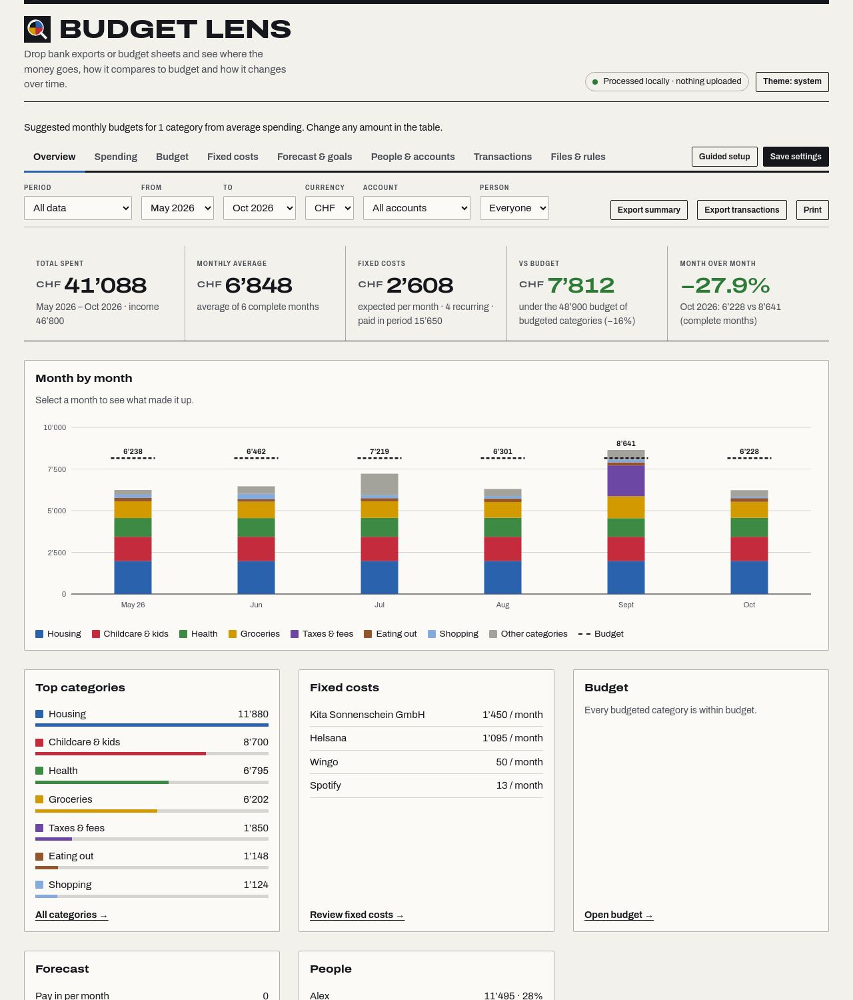
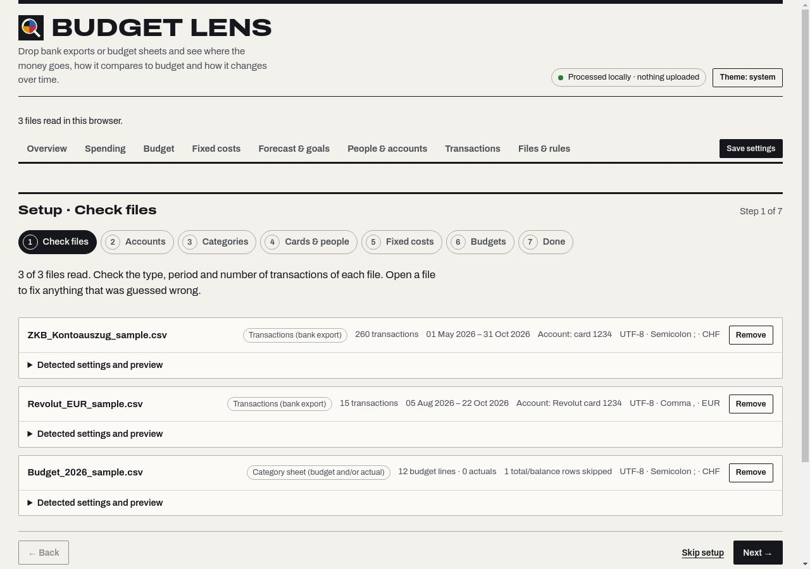
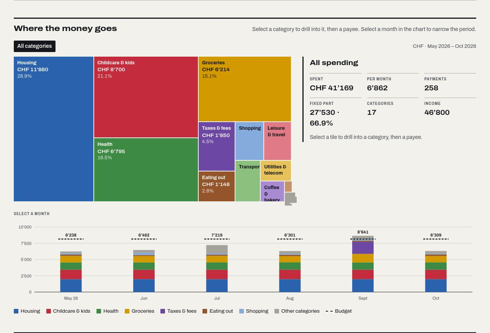
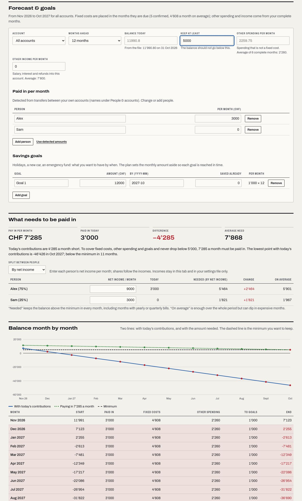

# Budget Lens

Drop one or more CSV files (bank exports or budget sheets) and see where the money goes, how it compares to budget and how it changes over time. Everything runs in the browser; the server only hands out static files.









## Security model

| Threat | Control |
| --- | --- |
| Financial data leaving the device | All parsing and analysis happen in the browser tab. The server has no upload endpoint, no database, no storage and accepts only `GET`/`HEAD` (everything else is `405`). CSP `connect-src 'none'` stops the page itself from making any network request (fetch, XHR, WebSocket, beacons). |
| Data lingering | No cookies, `localStorage`, `sessionStorage` or IndexedDB. Closing or reloading the tab forgets everything. The access log records method, path, status and duration only: no IPs, query strings or headers. |
| XSS from CSV content | The UI is built with DOM APIs only (`createElement`, `textContent`). There is no `innerHTML` or any other HTML sink, and CSP enforces Trusted Types with no policy allowed (`require-trusted-types-for 'script'; trusted-types 'none'`), so any sink use throws. There are no inline scripts or styles; styles are set through the CSSOM. |
| Third-party code | Go standard library only, no npm packages, no CDNs. The Archivo font is self-hosted (SIL OFL). CSP allows scripts, styles, fonts and images from the same origin only. |
| Hostile input | Limits on files (12), file size (15 MB), rows (100,000 per file, 300,000 total), columns (200) and cell length (1,000 characters). Control, zero-width and bidi-override characters are stripped from every cell. User-derived keys live in `Map`s, so names like `__proto__` are harmless. |
| Spreadsheet formula injection in exports | Text cells starting with `= + - @ \t \r %`, a pipe or a full-width variant get a leading `'`. Numbers stay numeric. |
| Framing, sniffing, leaks | `X-Frame-Options: DENY` and `frame-ancestors 'none'`, `nosniff`, `Referrer-Policy: no-referrer`, COOP/COEP/CORP, a restrictive `Permissions-Policy`, `X-Robots-Tag: noindex`, HSTS. HTTP requests get a 308 to HTTPS based on `X-Forwarded-Proto`. |
| Server hardening | Embedded file allowlist (`.html .css .js .svg .png .woff2 .txt`); dotfiles and unknown types are never served. Clean-path check (no `..`, backslashes or encoded separators). Read, write and idle timeouts, a 16 KB header limit and graceful shutdown. The runtime image is distroless, static and runs as non-root with no shell. |
| Unwanted visitors | Deploio basic auth is on by default (`.deploio.yaml`). |

Full header set: see `securityHeaders` and `contentSecurityPolicy` in `server.go`.

## Deploy on Deploio

```sh
nctl auth login
nctl create app budget-lens \
  --git-url=https://github.com/<org>/budget-lens \
  --dockerfile \
  --basic-auth \
  --size=micro \
  --port=8080
```

The build stage runs `go vet` and `go test` on `golang:1.27-alpine`. A failing test fails the deploy. The runtime image is `gcr.io/distroless/static-debian12:nonroot`. For reproducible builds, run `tools/pin-images.sh` (needs Docker): it pins both base images to their current digests in the Dockerfile. Run it again to pick up base-image patches, then commit.

`.deploio.yaml` sets the same defaults: `size: micro`, `port: 8080`, `enableBasicAuth: true` and a health probe on `/healthz`. Settings changed in Cockpit or with `nctl` take precedence over the file. Deploio checks app health with a TCP probe on the port by default. If your platform version doesn't support the `healthProbe` field, the TCP probe still applies and `/healthz` stays available for external monitoring.

**Basic-auth credentials**

```sh
nctl get app budget-lens --basic-auth-credentials   # show user and password
nctl update app budget-lens --change-basic-auth-password   # rotate
```

**Custom domain**

1. Find the default host (`*.deploio.app`) with `nctl get app budget-lens`.
2. At your DNS provider, add a CNAME from e.g. `budget.example.ch` to that default host. Also add the TXT record shown in Cockpit under *Hosts* (`"deploio-site-verification=…"`). Remove any AAAA records.
3. Add the host to the app: `nctl update app budget-lens --hosts="budget.example.ch"`. This replaces the existing list, so include any hosts you want to keep.
4. Deploio issues a Let's Encrypt certificate once DNS resolves.

## Run locally

```sh
go run .                                  # http://localhost:8080 (PORT overrides)
# or
docker build -t budget-lens . && docker run --rm -p 8080:8080 budget-lens
```

## Tests

```sh
go vet ./... && go test ./...             # server, headers, routing, gzip/ETag, static CSP checks on web/
node --test test/*.test.js                # parsing, detection, categorisation, analysis (Node 22+, no deps)
node tools/e2e.mjs --url http://127.0.0.1:8080 \
  --chrome "/Applications/Google Chrome.app/Contents/MacOS/Google Chrome"   # headless browser checks
```

`tools/e2e.mjs` drives Chrome over the DevTools protocol with no dependencies. It checks that the app starts empty, generates test files from `test/fixtures/sample.js` and drops them into the file input, then walks through the guided setup (accounts, categories, cards, fixed costs, budgets), loads the same export twice to check it is counted once, every page of the navigation, the drill-down from month to category to payee to transactions, fixed-cost confirmation and declaration, filters, sorting, search, the currency switch, per-file settings, rules, restoring a settings file and the exports. It also:

- Loads a CSV full of XSS, formula and bidi payloads and checks that nothing executes and nothing renders as HTML.
- Confirms Trusted Types and CSP block `innerHTML`, `fetch` and external images.
- Requires zero CSP violations and zero uncaught errors.
- Checks for horizontal overflow and clipped figures on desktop and mobile, in light and dark mode and in print.
- Checks that every control has an accessible name.

Screenshots and `report.json` go to `e2e-out/`. To attach to a browser that is already running, use `--cdp http://127.0.0.1:9222` instead of `--chrome`.

## Supported input

**Encodings:** UTF-8 (with or without BOM), UTF-16 LE/BE (BOM or zero-byte pattern), Windows-1252.
**Delimiters:** `,` `;` tab `|` (detected by consistency across lines, ignoring quoted text).
**Header row:** found by keyword and shape, so bank preambles (account number, period) and footers (disclaimers, totals) are skipped. Headerless files work too.
**Numbers:** `1'234.50`, `1’234.50`, `1,234.50`, `1 234.50`, `1.234,50`, `1 234,50`, `(45.00)`, `120.00-`, `−3.35`, `CHF 12.–`, with currency codes and symbols stripped.
**Dates:** `31.12.2026`, `31/12/26`, `12/31/2026` (detected when unambiguous), ISO with or without time, Excel serial numbers (under a date-like header), `1. Oktober 2026`, `Oct 5, 2026`, `3 févr. 2026`.

**Column roles,** detected from DE/FR/IT/EN headers and checked against the content:

| Role | Example headers |
| --- | --- |
| Date | Datum, Buchungsdatum, Booking date, Date de comptabilisation, Data contabile; value dates only as a fallback |
| Description | Buchungstext, Beschreibung1–3 (joined), Avisierungstext, Text, Libellé, Descrizione, Payee |
| Category | Kategorie, Category, Catégorie, Categoria, Posten, Position |
| Amount (±) | Betrag, Amount, Montant, Importo, Credit/Debit Amount |
| Money out / in | Belastung/Gutschrift, Lastschrift/Gutschrift, Debit/Credit, Soll/Haben (dated) |
| Budget / actual | Budget, Plan, Soll/Ist, Planned/Actual, Prévu/Réel, Previsto/Effettivo |
| Currency | Währung, Currency, Devise, Valuta (when the values are currency codes) |
| Debit/credit flag | S/H, DBIT/CRDT, D/C columns next to unsigned amounts |
| Ignored | Saldo/Balance, fees, IDs, references, IBAN, state, time |

**File types**

- **Bank exports.** UBS, PostFinance, ZKB, Raiffeisen and Revolut layouts are covered by tests; most other banks work through the same detection.
- **Category / Budget / Actual sheets,** including Soll/Ist. Actuals without dates are assigned to a month you choose.
- **Budget-only files.** Amounts count either per month (repeated over the selected period) or once for a chosen month.
- **Wide sheets with one column per month** (`Jan…Dez`, `2026-01`, `Oct 26`). They hold budgets by default, or actual spending when the file name says so; you can switch either way.
- **Totals.** `Total`, `Summe`, `Gesamt`, `Saldo` rows and columns are skipped.

Every detected setting can be changed per file under *Detected settings and preview*: encoding, delimiter, header row, file type, date and number format, sign convention, currency, budget scope and the role of each column. The live preview updates as you change them.

**Categories.** A category column from the file is used when present. Otherwise descriptions are matched against editable keyword rules for Swiss merchants (Migros, Coop, Denner, SBB, Helsana, Swisscom, ewz, Digitec Galaxus and others). The first matching rule wins. Keywords match whole words, and a trailing `*` matches word beginnings. Inflows that match a spending rule count as refunds; other inflows count as income. *Transfers & savings* is excluded from totals by default; any category can be toggled.

**Currencies** are never converted. The dashboard shows one currency at a time.

## Pages

On phones, wide tables you edit (budgets, accounts, cards, fixed costs, categories) turn into one card per row, with each value labelled.


| Page | What it shows |
| --- | --- |
| **Overview** | Total spent, monthly average, fixed costs per month, budget variance and month-over-month change; month-by-month chart; top categories, fixed costs, budget and people at a glance. |
| **Spending** | Treemap with drill-down: categories → payees → one payee's payments. A detail panel shows totals, average per month, share, fixed part and budget status at each level. Select any month in the chart to narrow everything to that month. Category include/exclude toggles, period comparison and the percentage calculator live here too. |
| **Budget** | Budget vs actual per category with editable monthly budgets. |
| **Fixed costs** | Detected and declared recurring payments (see below). |
| **Forecast & goals** | Month-by-month balance forecast for one account or all of them, with savings goals and the amount that has to be paid in, split between people. |
| **People & accounts** | Spending per person, account types and owners, card owners. |
| **Transactions** | Searchable, sortable list. The drill-down from other pages arrives as removable filter chips; *Fixed costs only* shows the recurring part. |
| **Files & rules** | Add files, check and adjust every detected setting per file, edit category rules, save settings, clear everything. |

Pages are addressed by the URL fragment (`#spending`, `#fixed` …), so the browser's back button works. The period, currency, account and person filters above the pages apply everywhere.

## Guided setup

Dropping the first files starts a seven-step setup. Every step can be skipped and the setup can be re-run any time (*Guided setup*).

1. **Check files.** What was detected per file: type, period, number of transactions, skipped rows, transactions also found in another file, and the account. Each file opens to show its settings and a preview. Warnings (for example "all amounts are positive") open automatically.
2. **Accounts.** The accounts found in the files, grouped automatically. Name them, mark each shared or individual with an owner, regroup files if needed, and list the names that identify transfers between your own accounts.
3. **Categories.** The biggest payees that no rule recognised: type or pick a category for each. Category names that come from your files can be mapped onto yours.
4. **Cards & people.** Say who each card belongs to, and see the resulting spending per person.
5. **Fixed costs.** Confirm or dismiss the recurring payments that were found, with the reason for each.
6. **Budgets.** Type monthly budgets, or let Budget Lens suggest them from average spending.
7. **Done.** Save the settings file for next time.

## How the numbers are made

- **Accounts.** Files are grouped into accounts by IBAN when the export contains one (in the header lines or a column; the IBAN checksum is verified). Otherwise files with the same bank layout that share a card number, or at least three identical transactions, count as the same account. You can split a file off or attach it to another account.
- **Duplicates.** Within one account, a transaction that appears in several files (overlapping exports) is counted once. Identical rows inside the same file (two coffees of 3.40 on one day) are kept.
- **Incomplete months.** A month is complete when the data covers it from day 1–3 to its last or second-to-last day. The monthly average uses complete months only. Month over month compares the last two complete months. Monthly budgets for an incomplete month are prorated by the days covered. Incomplete months appear lighter in the charts.
- **Money between own accounts.** It is a transfer, not income or spending, when the amount leaves one account and arrives in another within four days, or when the text names one of your people or the names you entered (for example a family name). Transfers are left out of totals by default.
- **Categories.** In this order: the category you chose for a payee, the file's own category (mapped through your aliases), keyword rules on the cleaned payee name, then keyword rules on the full description. Money in that matches a spending rule is a refund; other money in is income.
- **Sign.** A single amount column with negative values is read as "negative = money out". If a column has only positive amounts, the descriptions decide: salary, credit and refund wording means money in, anything else is treated as an expense list. A warning asks you to check either way.
- **Budget sheets.** Month columns without a year ("Jan", "Feb") use the current year; a warning says so and *Year of the month columns* changes it. Actual amounts without a date are counted in one month, which is also shown as a warning and can be changed. Spending within ±0.5% of the budget is *On budget*.
- **Person-to-person payments.** TWINT, Revolut and PayPal payments keep the person's name as payee ("Anna Muster (TWINT)"), so payments to different people stay apart.
- **Columns ignored on purpose.** Balance, fees, references, original/foreign amounts and currencies, exchange rates, individual amounts of collective orders, and "type of transaction" columns.

## Fixed costs

Payments to the same payee count as a fixed cost when they come back at a steady rhythm with a steady amount.

- **Rhythm.** The gaps between payments are measured in days, so a standing order that is booked on the 31st one month and the 1st the next is still monthly. Monthly, every two months, quarterly, half-yearly and yearly are recognised.
- **Amount.** The reference is the median of the largest payment per month. Smaller payments to the same payee, like the excess bills next to an insurance premium, don't distort it.
- **Signals.** Wording such as Dauerauftrag, standing order, eBill, LSV or direct debit, and categories like housing, insurance, utilities, childcare, subscriptions, health and taxes allow more tolerance. eBills paid on varying days are still monthly.
- **Not fixed.** Payees paid several times in most months, like supermarkets, are never fixed costs.

Clear cases (three or more payments, regular, steady amount) are confirmed automatically. Payments seen only twice are suggestions, as are less certain cases. Every detection lists its reasons, for example "monthly rhythm (2 of 2 gaps) · same amount every time · standing order or eBill · only seen 2 times so far".

You can confirm or dismiss each one, change its rhythm and expected amount (empty = any amount), or declare any payee a fixed cost. Payments within 15% (at least 5) of the expected amount count as fixed.

The figures are kept apart. *Expected per month* comes from the rhythm and amount. *Paid in period* is the sum of the matched payments. *Overdue* flags a fixed cost whose next payment is more than 10 days late compared with the newest data of its own account.

## Settings file

Nothing is stored in the browser. *Save settings* downloads `budget-lens-settings.json` with the following:

- **Accounts:** IBAN, or bank layout plus card numbers, along with name, type and owner. Accounts are recognised by these, not by file name, so next month's export with a new file name is still found.
- **People:** card owners and the names for own transfers.
- **Categories:** payee categories, category aliases, excluded categories and keyword rules.
- **Fixed costs and budgets:** your fixed-cost decisions and your budgets.

The file contains no transactions. It does hold names, IBANs, card endings, payee names and amounts of fixed costs, and budgets, so treat it as private. Drop it in together with your CSV files next time to restore everything.

Settings files from the first version still load. Their account names can't be carried over, because they were tied to file names; the app says so.

The loader treats the file as untrusted. It is limited to 1 MB and accepts only the expected shape. IBAN, card and key formats are checked, and every string is cleaned and limited in length. Values go into `Map`s, so `__proto__` and similar keys cannot pollute objects. The tab asks for confirmation before closing while there are unsaved settings.

## Forecast & goals

The forecast projects an account (or all accounts) month by month for 6 to 36 months. It starts from:

- **Balance today:** the latest balance in the export, if it has a balance column; you can type your own.
- **Fixed costs:** every confirmed fixed cost, placed in the months it is due, so quarterly and yearly bills land where they belong. Overdue ones are placed in the first month.
- **Other spending:** the average spending that is not a fixed cost, from the last six complete months.
- **Other income:** salary, interest and refunds coming into the account.
- **Paid in:** money each person transfers in, recognised from transfers between your own accounts by the names under People & accounts. You can change the amounts or add people.
- **Savings goals:** name, amount, target month and amount already saved. Each goal gets the monthly amount that reaches it in time.
- **Keep at least:** the minimum balance the account should not drop below.

From this the page works out two amounts. *Pay in per month* is the smallest constant monthly amount that keeps the balance above the minimum in every month, including months with yearly or quarterly bills. *Average need* is enough over the whole period but can dip in expensive months. Both are compared with what is paid in today.

The amount can be split between people in four ways:

- like today's ratio
- equally
- in proportion to net incomes you enter (they stay in the tab and in your settings file)
- by your own percentages

A chart shows the balance with today's contributions and with the needed amount, and a table lists every month. Everything you enter on this page is part of the settings file.

## Budgets

The *Budget vs actual* table has an editable **monthly budget** per category. A value typed there replaces any budget a file provides for that category; `0` removes it; an empty field falls back to the file. *Suggest from average spending* fills every category that has no budget with its monthly average, rounded up to the next 10. Monthly budgets are multiplied by the number of months in the selected period.

*Download budget CSV* saves the current monthly budgets as `Category, Monthly budget`, a file any spreadsheet can open and Budget Lens can load again. To keep everything else too, use *Save settings* (see below).

## People, cards and accounts

Every bank account found in your files is an **account**. In *People and accounts* you can:

- **Name the account.** Files of the same account are grouped automatically (see *How the numbers are made*).
- **Mark it shared or individual.** An individual account has an owner, and all of its spending counts as that person's.
- **Assign cards to people.** Card numbers are read from the descriptions (`xxxx 1234`, `Karte Nr. XXXX1234`, `*1234`). On a shared account, card payments count for the card's owner and everything else (rent, bills, standing orders) counts as *Shared*.

The summary shows spending, share and top categories per person. The *Account* and *Person* filters in the toolbar narrow the whole dashboard, compare table and exports. The transaction export includes account, card and person columns. Transfers between your own accounts land in *Transfers & savings*, which is excluded by default, so money moved between your own accounts is neither spending nor income.

The app ships without any data: it starts empty and shows nothing until you add your own files.

## Layout

```
main.go, server.go     static server (embed, allowlist, headers, gzip, ETag, healthz, redirect, shutdown)
server_test.go         server and static front-end checks
web/                   everything that is served
  js/                  ES modules: csv, numbers, dates, detect, categorize, analyze, pipeline, accounts, people,
                       budget, recurring, settings (no DOM, unit-tested); app, charts, dom, format (UI)
  assets/              CSS and the Archivo font
test/                  node:test unit tests; fixtures/sample.js generates made-up bank files for tests
tools/e2e.mjs          headless-browser checks (dev only, not shipped)
```
